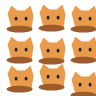
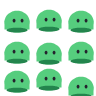

# YimyWalk 角色包格式（M4.1）

角色包是一个目录。最小格式只有一张透明 PNG：

```text
Characters/<id>/
  sprite.png
```

`<id>` 是目录名。应用不会执行角色目录里的脚本、命令或外部资源。`sprite.png` 必须是带 Alpha 的 PNG，宽高都能被 3 整除，图像按从左到右、从上到下切成九个等大的格子。当前限制由 Core 的 `CharacterLoader` 执行：单边最多 2048 像素、总像素最多 16,777,216、PNG 最多 32 MiB，并拒绝损坏、全透明或没有 Alpha 的输入。

## 九格协议

| 索引 | 含义 | 使用方式 |
| ---: | --- | --- |
| 0–2 | 发呆 | 按 `idleFps` 循环 |
| 3–5 | 朝右走路 | 按 `walkFps` 循环；朝左由程序水平翻转 |
| 6 | 起跳 | 上升阶段使用 |
| 7 | 最高点附近 | 短暂使用，不是循环动画 |
| 8 | 下落 | 下降阶段使用 |

第三排不是普通循环动画。直接从屏幕上方生成或拖拽释放时可以从下落帧开始。默认脚底锚点为单格宽度的 `0.5`、单格高度的 `0.9`；配置中的锚点仍以单格比例填写。

## 可选文件

```text
Characters/<id>/
  sprite.png
  character.json   # 可选
  dialogue.txt     # 可选
```

缺少 `character.json` 或 `dialogue.txt` 时使用 Core 内置默认值，因此只有 `sprite.png` 的目录可以直接运行。当前支持的配置字段如下（速度和重力单位是像素/秒及像素/秒²）：

```json
{
  "schemaVersion": 1,
  "displayName": "示例小猫",
  "scale": 1.0,
  "anchor": { "x": 0.5, "y": 0.9 },
  "animation": { "idleFps": 3, "walkFps": 8 },
  "movement": {
    "walkSpeed": 60,
    "jumpSpeed": 450,
    "gravity": 1500,
    "maxFallSpeed": 1500
  },
  "behavior": {
    "idleSecondsMin": 2,
    "idleSecondsMax": 8,
    "hungerIncreasePerMinute": 0.01,
    "speechCooldownSeconds": 45
  }
}
```

缺少字段会回退默认值；`schemaVersion` 若出现必须为 `1`。当前未知 JSON 属性会被忽略，不能依赖它们改变行为。数值必须是有限数并落在 Loader 的限制内，`idleSecondsMax` 不能小于 `idleSecondsMin`。

`dialogue.txt` 使用 UTF-8。空行以及以 `#` 或 `;` 开头的行会忽略；用 `[idle]`、`[walk]`、`[jump]` 等标题切换分组。缺少分组会回退内置台词。每个角色最多 1000 行，每行最多 500 个字符，文件最多 256 KiB。

## 校验和预览

验证器直接调用运行时使用的 `YimyWalk.Core.CharacterLoader`，不会生成窗口，也不会修改角色文件。工作区 SDK 已准备好后运行：

```powershell
powershell -NoProfile -ExecutionPolicy Bypass -File scripts/validate-character.ps1 `
  -Path .\Characters\slime `
  -PreviewPath .\artifacts\slime-preview.png `
  -ReferencePath .\docs\assets\character-grid-reference.png
```

成功返回 0，并报告尺寸、单格尺寸、Alpha、九帧映射、配置来源、对白来源、缩放和锚点。角色无效返回 1 并保留上一条可读错误；参数或工具使用错误返回 2。输入目录可以包含空格和中文。预览是由九个已解码帧重新组合的 PNG，参考图只包含 3×3 网格和默认锚点示意；两者都不写回 `sprite.png`。校验失败时不会创建或替换预览输出，若目标已有文件则保持原样并打印提示。

仓库中的 `Characters/slime`、`Characters/咿米_Yimy` 和 `Characters/咿米_Line` 是随发布包提供的 sprite-only 初始角色。后两者分别来自用户提供的 `Yimy.jpg` 和 `Yimy_no.jpg`，文件实际为透明 PNG，原样保存为 `sprite.png`，整图 1254×1254、单格 418×418。`cat` 仅保留在 `tests/Fixtures/Characters/cat` 供测试使用。`examples/character-template` 提供带配置和对白的作者模板；`docs/assets/character-grid-reference.png` 是不应放进运行时 sprite 的参考图。

预览示例：




## 当前边界

本阶段支持 3×3 基础动作、可选配置和对白，以及工具生成的静态预览。`actions.png`、额外动作映射、逐角色用户覆盖层、脚本和远程资源尚未实现；把它们放进目录不会启用这些功能。完整角色刷新界面属于后续阶段，但刷新失败保留旧定义、旧绘制资源在无实例和无在途引用后释放的生命周期约束已经由宿主负责。
